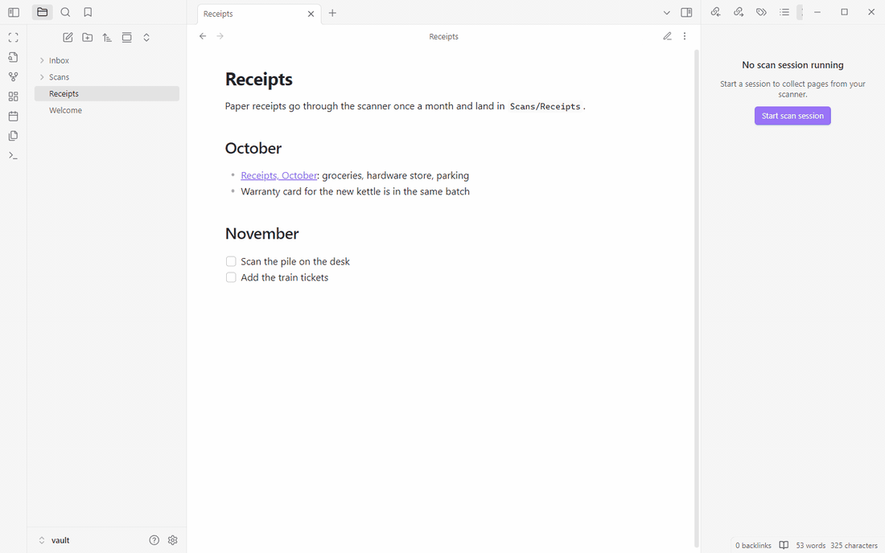
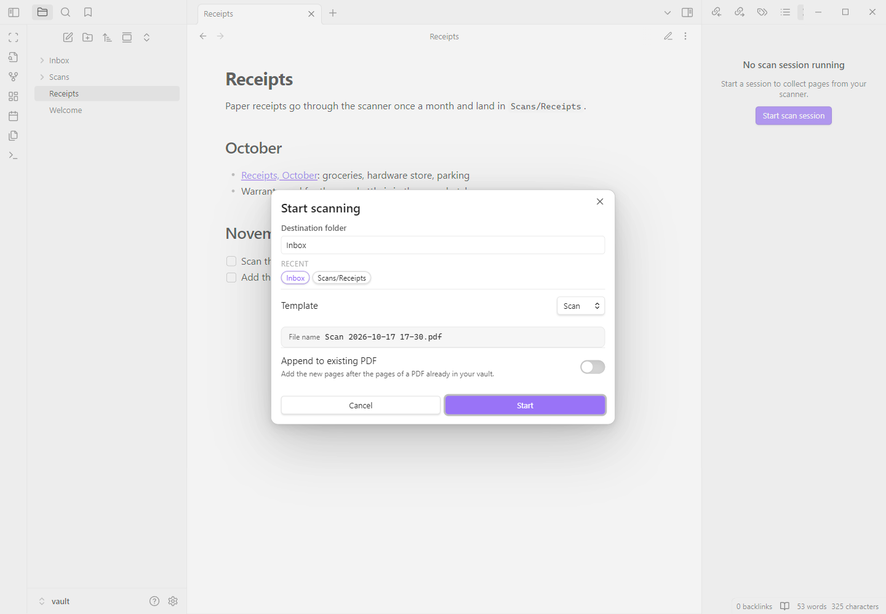
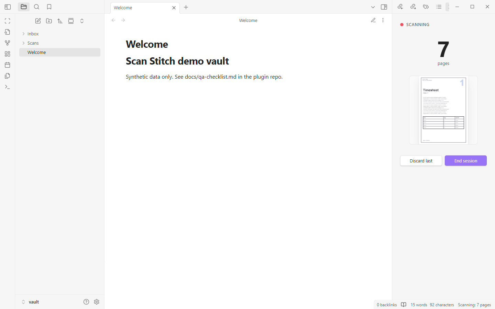
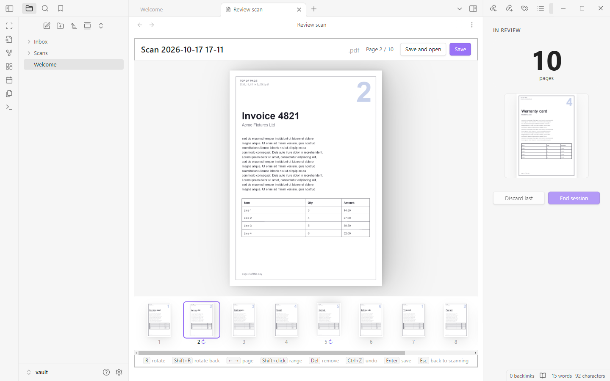
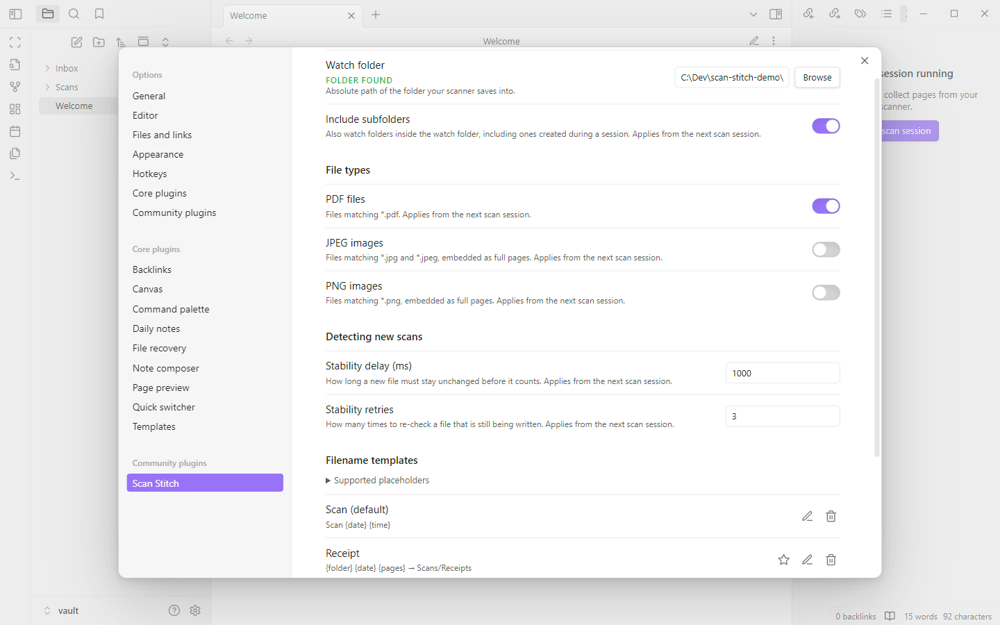

<div align="center">

<picture>
  <source media="(prefers-color-scheme: dark)" srcset="assets/logo-wordmark-dark.svg">
  
</picture>

**Turn a scanner's one-file-per-page output into a single, correctly rotated PDF in your Obsidian vault.**

[](LICENSE)



<a href="https://buymeacoffee.com/codingjinxx"></a>

</div>

## Why

Many flatbed and sheet-fed scanners save **one file per page** into a folder: `IMG_0001.pdf`, `IMG_0002.pdf`, and so on, often restarting the numbering in a new folder every day. Turning a stack of those into one PDF, with every page the right way up, is tedious by hand. Scan Stitch makes it a short session: start, scan while Obsidian is open, end, fix rotation with a few key presses, save.

## Features

- **Works with any scanner** that writes files into a folder. Point it at the folder once; subfolders (such as one folder per day) are included, even ones created mid-session.
- **PDF, JPEG and PNG pages.** Multi-page PDFs are split into separate reviewable pages. Images become full pages (EXIF orientation applied, sized from their DPI or 150 DPI).
- **Live side pane** while you scan: a large page counter, a preview of the last page, **Discard last** and **End session**. A status bar item shows the count too.
- **Keyboard-first review**: one large page plus a filmstrip. Rotate, reorder by dragging, delete, select a range, undo and redo.
- **Filename templates** with placeholders such as `{date}`, `{counter}` and `{pages}`, saved as named templates, optionally with a default destination folder.
- **Append** the new pages to a PDF that is already in your vault, verified before the original is replaced.
- **Recent destinations**: the last 5 folders you saved to are one click (or one Enter) away.
- **Nothing is lost** if Obsidian closes mid-session: the session is stored and offered for resume on the next start.
- **Read only outside the vault**: the scanner folder is never modified. No network access.

## How it works

**1. Start a session.** Click the scan icon in the ribbon or run **Start scan session**. Pick the destination folder (the most recent one is preselected) and a filename template; the file name preview updates live.

<picture>
  <source media="(prefers-color-scheme: dark)" srcset="assets/screenshots/start-dialog-dark.png">
  
</picture>

**2. Scan.** Feed pages to your scanner as usual. Each new file appears in the side pane a few seconds after the scanner finishes writing it. Scanned a page twice? Press **Discard last**.

<picture>
  <source media="(prefers-color-scheme: dark)" srcset="assets/screenshots/scan-pane-dark.png">
  
</picture>

**3. Review.** Press **End session** to open the review screen. Fix the pages that came out the wrong way with `R` or `Shift+R`, drag thumbnails to reorder, delete strays with `Del`.

<picture>
  <source media="(prefers-color-scheme: dark)" srcset="assets/screenshots/review-dark.png">
  
</picture>

**4. Save.** Press `Enter` or **Save** to write one PDF into the destination folder, or **Save and open** to open it straight away. The session ends.

## Install

Scan Stitch is **desktop only** and needs Obsidian 1.5.0 or newer. It is tested on Windows; see [Limitations](#limitations).

**From Community plugins:** the listing is pending review. Once it is listed, open Settings → Community plugins → Browse, search for "Scan Stitch", install and enable it.

**Manually:**

1. Open the [latest release](https://github.com/CodingJinxx/scan-stitch/releases/latest) (releases are named by the bare version, for example `1.0.0`).
2. Download `main.js`, `manifest.json` and `styles.css`.
3. Put them in `<your vault>/.obsidian/plugins/scan-stitch/` (create the folder if needed).
4. Restart Obsidian or reload plugins, then enable **Scan Stitch** under Settings → Community plugins.
5. In Settings → Scan Stitch, set **Watch folder** to the folder your scanner saves into.

### Limitations

- **Windows is the only fully tested platform.** macOS and Linux are untested; they are expected to work through the polling fallback (besides listening for file system events, the folder is rescanned every 3 seconds).
- **Desktop only.** Obsidian mobile cannot read folders outside the vault.
- **No automatic rotation.** You rotate the wrong-way pages yourself; it takes one key per page, or one for a whole range.
- **No OCR.** The PDF contains the scanned pages as they are, so their text is not searchable unless the scanner already made it so.
- **No TIFF.** Only PDF, JPEG and PNG files are read.
- **Files rewritten in place are ignored.** A file that already existed when the session started and is then overwritten under the same name is not picked up. (After an Obsidian restart and resume it may be, because the list of old files is kept in memory only.)

## Usage

### Commands

All commands are in the command palette under "Scan Stitch". None has a default hotkey; assign your own in Settings → Hotkeys.

| Command | Id | Available |
|---|---|---|
| Start scan session | `start-session` | Always. If a session is already open, asks whether to resume or replace it. Also the ribbon icon. |
| End scan session | `end-session` | While scanning. Opens the review screen. |
| Discard last scanned page | `discard-last-page` | While scanning with at least one page. |
| Resume scan session | `resume-session` | Reopens the open or stored session, in the scan pane or the review screen, wherever it was. |

Clicking the status bar counter ("Scanning: 7 pages") also ends the session and opens the review.

### Scanning

Only files that appear in the watch folder **after** the session starts are counted; pages already there are ignored. Pages are ordered by the time each file finished writing, not by file name, so the restarting `IMG_0001` numbering in day folders does not matter.

**Discard last** removes the newest file from the session (all pages of it, if it is a multi-page PDF). The file on disk stays where it is; the plugin just remembers to ignore it. Press it again to discard the page before. A rescan arrives as a new file at the end.

### Review screen keyboard shortcuts

The review screen opens on page 1. While the file name field has focus, only `Enter` (save) and `Esc` (leave the field) are handled.

| Key | Action |
|---|---|
| `R` | Rotate 90° clockwise (the current page, or every selected page) |
| `Shift+R` | Rotate 90° counter-clockwise |
| `←` / `→` | Previous / next page |
| `Home` / `End` | First / last page |
| `Del` or `Backspace` | Remove the current page, or every selected page |
| `Ctrl+Z` (`Cmd+Z` on macOS) | Undo rotate, remove or reorder |
| `Ctrl+Y` or `Ctrl+Shift+Z` (`Cmd` on macOS) | Redo |
| `Ctrl+A` (`Cmd+A`) | Select all pages |
| `Enter` | Save |
| `Esc` | Back to scanning. With unsaved changes, asks: **Keep scanning**, **Discard session** or **Cancel** |
| Click a thumbnail | Jump to that page |
| `Shift`+click a thumbnail | Select the range from the current page to that one |
| Drag a thumbnail | Move the page to a new position |

Rotated pages show a small `↻` marker in the filmstrip. Rotation is added on top of whatever rotation the page already had.

### Filename templates

A template is a pattern with placeholders in braces. The default template is called "Scan": `Scan {date} {time}`.

| Placeholder | Becomes | Example |
|---|---|---|
| `{date}` | Session start date, `YYYY-MM-DD` | `2026-10-17` |
| `{time}` | Session start time, `HH-mm` | `17-11` |
| `{year}` | Four-digit year | `2026` |
| `{month}` | Two-digit month | `10` |
| `{day}` | Two-digit day | `17` |
| `{pages}` | Number of pages, filled in when saving (`?` in previews) | `12` |
| `{counter}` | Next unused number for that name in the destination folder | `3` if `Invoice 1` and `Invoice 2` exist |
| `{folder}` | Name of the destination folder | `Receipts` for `Scans/Receipts` |

The five date and time placeholders take an optional format after a colon, using [moment.js format tokens](https://momentjs.com/docs/#/displaying/format/): `{date:DD.MM.YYYY}` gives `17.10.2026`, `{time:HH-mm-ss}` gives `17-11-42`, `{date:YYYYMMDD}` gives `20261017`.

- Names are sanitised: `\ / : * ? " < > |` and control characters are removed, trailing dots and spaces are trimmed, and Windows reserved names such as `CON` get a leading `_`. So avoid `:` in a time format; `{time:HH:mm}` would become `1711`.
- **Nothing is overwritten.** If the name already exists in the destination, ` 2`, ` 3`, ... is appended.
- Unknown placeholders are kept as literal text and flagged in the template editor.
- Templates are named and saved in Settings → Scan Stitch → Filename templates. One is the default. A template can store a destination folder, which the start dialog then preselects.
- The file name can still be edited in the review screen's top bar before saving.

Example: `Receipts {date:YYYY-MM} {counter} ({pages} p)` saved into `Scans/Receipts` gives `Receipts 2026-10 1 (3 p).pdf`.

### Append mode

Turn on **Append to existing PDF** in the start dialog and pick a PDF in your vault. The new pages are added after the existing pages:

- The review screen shows only the new pages; the header reads "Appending to *file* (N existing pages)". The existing pages cannot be changed there.
- The file name field is hidden because the target file is fixed.
- Before replacing the file, the merged result is reopened and its page count checked. A copy of the original is kept in `.obsidian/plugins/scan-stitch/backups/` until the write succeeds; if anything fails, the original stays as it was and the copy is kept.

## Settings

<picture>
  <source media="(prefers-color-scheme: dark)" srcset="assets/screenshots/settings-dark.png">
  
</picture>

| Setting | Default | What it does |
|---|---|---|
| Watch folder | empty | Absolute path of the folder your scanner saves into. Type it or use **Browse**. Shows "Folder found" or "Folder not found". |
| Include subfolders | on | Also watch folders inside the watch folder, including ones created during a session. |
| PDF files | on | Count `*.pdf` files. |
| JPEG images | off | Count `*.jpg` and `*.jpeg` files, embedded as full pages. |
| PNG images | off | Count `*.png` files, embedded as full pages. |
| Stability delay (ms) | 1000 | How long a new file must stay unchanged before it counts. 100 to 30000. |
| Stability retries | 3 | How many times to re-check a file that is still being written. 1 to 20. |
| Filename templates | "Scan": `Scan {date} {time}` | Add, edit, delete templates and choose the default. The last template cannot be deleted. |
| Recent destination folders | none | The last 5 folders saved to. **Clear** empties the list. |

At least one file type must stay enabled. Folder, file type and stability changes apply from the next scan session.

## Privacy and file access

Obsidian's developer policies ask plugins to explain any access outside the vault, so here it is plainly:

- **Desktop only.** The plugin uses Node's file system API, which Obsidian provides only on desktop.
- **Reads files outside your vault.** It reads PDF, JPEG and PNG files from the scanner folder you configure, which is normally outside the vault. That is the whole point: your scanner writes there, and Scan Stitch picks the pages up from there. The **Browse** button in the settings opens your system's local folder picker; nothing is sent anywhere.
- **Never changes the scanner folder.** It never modifies, moves, renames or deletes anything in it. "Discard last" and "Discard session" only change what the plugin remembers; the files stay.
- **Writes only into the vault**: the merged PDF in the destination folder, and (in append mode) a temporary backup copy in the plugin's own folder.
- **No network access, no telemetry, no account.** The plugin makes no network requests.
- **Session state** (scanner folder path, destination, template, the list of page file paths with their rotations, discarded paths, start time) is stored in the plugin's `data.json` in `.obsidian/plugins/scan-stitch/`, together with your settings and recent folders.

## FAQ

**Which scanners does it work with?**
Any scanner, scanner app or phone sync tool that saves one file per page (or a few pages per file) as PDF, JPEG or PNG into a folder the computer can read. The plugin does not talk to the scanner or its driver; it only reads the files.

**Why desktop only?**
Watching a folder outside the vault needs Node's `fs`, which Obsidian mobile does not provide.

**Why does a page take about 4 seconds to appear?**
A file only counts once it has stopped growing, so half-written files are never merged. The plugin reads the file size every *Stability delay* and needs *Stability retries* + 1 readings, the last ones unchanged: 1000 ms × (3 + 1) = about 4 s with the defaults. To speed it up, lower the delay (for example 300 ms) or the retries (for example 1, giving 2 readings: about 0.6 s). If your scanner writes slowly, or over a network share, raise them instead.

**What happens if Obsidian closes in the middle of a session?**
Nothing is lost. The session is saved as it changes. On the next start Scan Stitch asks whether to **Resume**, **Drop** or decide **Later** (then use **Resume scan session**). Pages that arrived while Obsidian was closed are picked up if they are newer than the session start. Page files that no longer exist are skipped with a notice.

**Why is TIFF not supported?**
pdf-lib, the PDF library the plugin uses, cannot embed TIFF images, and Obsidian's web view cannot display them. Set your scanner to PDF, JPEG or PNG.

**I started a session and the pages already in the folder were not picked up.**
That is intended: only files created or modified after the session start count. Files that were already there are ignored.

**I rescanned into an existing file name and it was not picked up.**
A file that already existed when the session started and is then overwritten in place is not picked up during that session; the plugin has already noted it as an old file. Let the scanner write a new file instead. (After a restart and resume such a file may be picked up, because that note is kept in memory only.)

**How do I rotate a whole batch at once?**
Click the first page of the batch in the filmstrip, `Shift`+click the last, then press `R` (or `Shift+R`). `Ctrl+A` then `R` rotates every page.

**Does "Discard last" delete the file?**
No. It only removes the page from the session. The file stays in the scanner folder and is ignored for the rest of the session.

## Development

Requires Node.js 22.12 or newer.

```bash
npm ci
npm run dev        # esbuild in watch mode, writes main.js
npm test           # vitest
npm run lint       # eslint with eslint-plugin-obsidianmd
npm run typecheck  # tsc --noEmit
npm run build      # production bundle: main.js
```

To try it in Obsidian without using real documents:

```bash
npm run build
node scripts/install-demo.mjs <vaultDir>          # copies main.js, manifest.json, styles.css into <vaultDir>/.obsidian/plugins/scan-stitch
node scripts/make-demo-scans.mjs <scannerDir>     # synthetic one-PDF-per-page scanner output, a few pages deliberately the wrong way round
node scripts/make-demo-scans.mjs --drip <stagedDir> <scannerDir> 4   # copies one file every 4 s to simulate a scanner
```

The defaults are `C:\Dev\scan-stitch-demo\vault` for the vault; see the comments at the top of each script for all options. The full manual test plan is in [docs/qa-checklist.md](docs/qa-checklist.md); the design is in [docs/superpowers/specs/2026-10-17-scan-stitch-design.md](docs/superpowers/specs/2026-10-17-scan-stitch-design.md).

## Support

Scan Stitch is free and open source. If it saves you time, you can buy me a coffee; it is never expected, and it helps me keep maintaining it.

<a href="https://buymeacoffee.com/codingjinxx"></a>

## Contributing

Bug reports, ideas and pull requests are welcome. See [CONTRIBUTING.md](CONTRIBUTING.md).

## Licence

[MIT](LICENSE) © 2026 Jay Leimer

## Acknowledgements

- [pdf-lib](https://pdf-lib.js.org/) for merging and writing PDFs (MIT).
- The logo wordmark is set in [Bricolage Grotesque](https://fonts.google.com/specimen/Bricolage+Grotesque) and [Figtree](https://fonts.google.com/specimen/Figtree), both under the SIL Open Font License 1.1.
